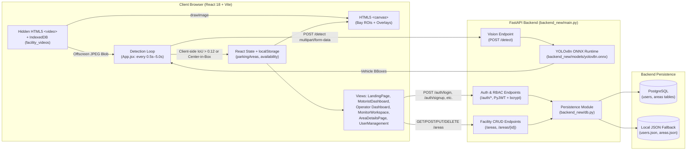
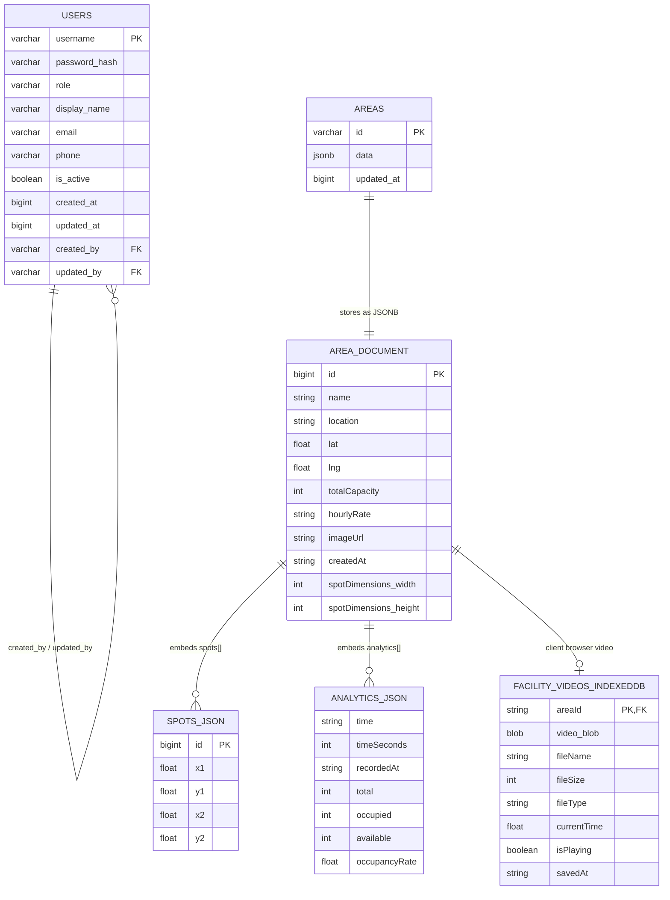
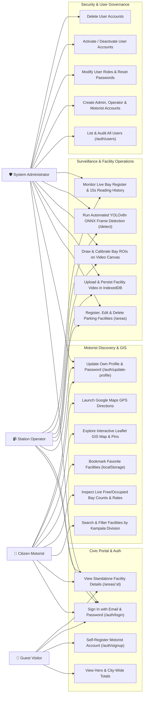

# KCCA Digital Parking System (ParkWatch) — Technical Summary

> **Scope & Verification Rule:** This document is generated strictly from an inspection of the repository at `C:\Users\Anthony.kimbugwe\Desktop\Parking System 2`. Claims cite exact relative file paths. Features not present in the codebase are marked **Not implemented**.

---

## 1. Stack and Environment

### 1.1 Languages
| Language | Where Used | Evidence / File Paths |
| :--- | :--- | :--- |
| **Python** (3.10.12 pinned for cloud; 3.14.8 local; 3.8+ in docs) | Active FastAPI backend, legacy Flask backend, CLI utilities, icon subsetting, API tests | `backend_new/render.yaml` (`PYTHON_VERSION: 3.10.12`), `backend_new/main.py`, `backend_new/db.py`, `backend_new/create_user.py`, `backend/app.py`, `scratch/test_signup_api.py` |
| **JavaScript (ESNext / JSX & CommonJS)** | React 18 SPA frontend (`.jsx`, `.js`) and Playwright verification suites (`.cjs`) | `frontend/src/App.jsx`, `frontend/vite.config.mjs` (`target: 'esnext'`), `scratch/*.cjs`, `frontend/_archive/*.cjs` |
| **HTML5 & CSS3** | SPA entry document and Tailwind CSS v4 stylesheet | `frontend/index.html`, `frontend/src/index.css`, `frontend/_archive/App.css` |
| **SQL (PostgreSQL dialect)** | Relational DDL and DML queries inside the database persistence module | `backend_new/db.py` (lines 88–175, 238–350) |
| **Windows Batch (`.bat`)** | Local virtualenv creation and server startup scripts | `backend_new/start.bat`, `backend/start.bat` |
| **PHP (`composer.json`)** | **Not implemented** | No `composer.json` or `.php` files exist in the repository |

### 1.2 Frameworks and Versions
| Layer | Framework / Tool | Version | Source File |
| :--- | :--- | :--- | :--- |
| **Active Backend API** | FastAPI | `>=0.104.1` | `backend_new/requirements.txt` |
| **ASGI Server** | Uvicorn (`uvicorn[standard]`) | `>=0.24.0` | `backend_new/requirements.txt` |
| **Production Process Manager** | Gunicorn | `>=21.2.0` | `backend_new/requirements.txt` |
| **Data Validation** | Pydantic | `>=2.5.0` | `backend_new/requirements.txt` |
| **Legacy Backend API** | Flask / Flask-CORS | `3.0.0` / `4.0.0` | `backend/requirements.txt`, `backend/app.py` |
| **Frontend UI Library** | React / React DOM | `^18.2.0` | `frontend/package.json` |
| **Client-Side Routing** | React Router DOM | `^7.18.5` | `frontend/package.json` |
| **Frontend Build & Bundler** | Vite / `@vitejs/plugin-react` | `^5.0.0` (`v5.4.21` in `frontend_dev.log`) / `^4.2.0` | `frontend/package.json`, `frontend/vite.config.mjs` |
| **Styling Framework** | Tailwind CSS / `@tailwindcss/vite` | `^4.3.5` | `frontend/package.json`, `frontend/vite.config.mjs` |
| **E2E Browser Testing** | Playwright | `^1.65.0` | `frontend/package.json` |

### 1.3 Key Packages
* **Active Backend (`backend_new/requirements.txt` and identical `backend_new/requirements-render.txt`):**
  * `fastapi>=0.104.1`, `uvicorn[standard]>=0.24.0`, `python-multipart>=0.0.6` (multipart frame uploads)
  * `onnxruntime>=1.16.0` (CPU inference for YOLOv8n ONNX)
  * `Pillow>=10.1.0`, `numpy>=1.26.0` (image decoding, resizing, tensor manipulation, NMS)
  * `bcrypt>=4.1.0`, `PyJWT>=2.8.0` (password hashing and HS256 JWT authentication)
  * `psycopg2-binary>=2.9.9` (PostgreSQL driver)
  * `gunicorn>=21.2.0`
* **Legacy Backend (`backend/requirements.txt`):**
  * `flask==3.0.0`, `flask-cors==4.0.0`, `transformers>=4.36.0`, `torch>=2.1.0`, `Pillow>=10.1.0`, `numpy>=1.26.0`
* **Active Frontend (`frontend/package.json`):**
  * Runtime dependencies: `react` (`^18.2.0`), `react-dom` (`^18.2.0`), `react-router-dom` (`^7.18.5`), `leaflet` (`^1.9.4` for interactive OpenStreetMap GIS maps), `material-symbols` (`^0.48.3` subsetted into `frontend/src/assets/material-symbols-outlined.woff2` and `frontend/src/iconCodepoints.json`).
  * DevDependencies: `@tailwindcss/vite` (`^4.3.5`), `tailwindcss` (`^4.3.5`), `@vitejs/plugin-react` (`^4.2.0`), `vite` (`^5.0.0`), `playwright` (`^1.65.0`), `@types/react` (`^18.2.0`), `@types/react-dom` (`^18.2.0`).
  * Root `package-lock.json`: Leftover lockfile from an earlier single-folder layout listing `onnxruntime-web` (`^1.16.3`) and `concurrently` (`^10.0.7`); no root `package.json` exists (`PROJECT_STRUCTURE.md` line 40).

### 1.4 Database & Storage Engines
1. **PostgreSQL (Cloud Primary):** Configured via `DATABASE_URL` in `backend_new/db.py` (lines 19, 58–78) using `psycopg2` with `autocommit = True`. Provisioned in `backend_new/render.yaml` as `kcca-parkwatch-db` (`databaseName: kcca_parkwatch`, `user: parkwatch_admin`).
2. **Local JSON Files (Fallback & Sync Mirror):** `backend_new/users.json` and `backend_new/areas.json`. When `DATABASE_URL` is unset or PostgreSQL is unreachable, `backend_new/db.py` reads and writes directly to these JSON files and syncs local writes whenever `write_users()` or `write_areas()` is called (`backend_new/db.py` lines 232–351). *(Note: `backend_new/db.py` line 4 mentions SQLite in a docstring comment, but SQLite is **Not implemented** in code).*
3. **Browser IndexedDB (Client-Side Video Storage):** Database `KCCA_ParkWatch_Media` (version `1`), object store `facility_videos` (`keyPath: 'areaId'`), managed by `frontend/src/utils/videoStorage.js` (lines 7–30) to store uploaded surveillance video blobs locally in the operator's browser.
4. **Browser `localStorage` (Client-Side State & Cache):** Caches `parkingAreas`, JWT credentials (`parkwatch_token`, `parkwatch_user`, `parkwatch_role`, `parkwatch_display_name`, `parkwatch_last_identifier`), theme (`kcca_theme`), motorist favorites (`kcca_motorist_favorites`), and video playback state (`parkwatch_playback_<areaId>`) (`frontend/src/App.jsx`, `frontend/src/components/MotoristDashboard.jsx`, `frontend/src/utils/videoStorage.js`).

### 1.5 Deployment Configuration
* **Backend (Render.com):**
  * Defined in both root `render.yaml` and `backend_new/render.yaml` (service name `kcca-parkwatch-api`, Python runtime, free plan, `rootDir: backend_new`, `buildCommand: pip install --no-cache-dir -r requirements.txt`, `startCommand: uvicorn main:app --host 0.0.0.0 --port $PORT`).
  * `backend_new/Procfile` also defines `web: uvicorn main:app --host 0.0.0.0 --port $PORT`.
  * Environment template `backend_new/.env.example` specifies `PORT=8001`, `JWT_SECRET`, and `FRONTEND_URL`.
* **Frontend (Vercel / Netlify / Static CDN):**
  * `frontend/vercel.json` rewrites `/(.*)` to `/index.html`.
  * `frontend/public/_redirects` (copied to `frontend/dist/_redirects`) configures `/* /index.html 200`.
  * `frontend/.env.example` defines `VITE_API_URL=https://your-backend-app.onrender.com`. In `frontend/src/App.jsx` (lines 33–38), `API_URL` defaults to `http://localhost:8001` on `localhost`/`127.0.0.1` and `https://kcca-parkwatch.onrender.com` otherwise.

---

## 2. Architecture

### 2.1 Component Connectivity


1. **Camera / Video Input:** The system does not connect to live RTSP/IP camera streams. Instead, an operator uploads a video file (`MP4`, `WebM`, etc.) per facility in `MonitorWorkspace.jsx` (`frontend/src/App.jsx` lines 929–998). The binary `File`/`Blob` is persisted in browser IndexedDB (`frontend/src/utils/videoStorage.js`) and bound to a hidden `<video>` element (`frontend/src/App.jsx` line 1238), whose frames are painted onto a visible `<canvas>` at 60 FPS via `requestAnimationFrame` (`frontend/src/App.jsx` lines 344–486).
2. **Detection Pipeline:** While a video is playing (or when forced on video load, seek, spot draw, or "Scan Current Frame"), `detectVehiclesInCurrentFrame()` in `frontend/src/App.jsx` (lines 1065–1159) draws the current `<video>` frame onto an offscreen canvas, encodes it as a JPEG blob (`quality = 0.85`), and sends it via `POST /detect` (`multipart/form-data`) to `backend_new/main.py`.
3. **Backend Vision & API:** `backend_new/main.py` runs YOLOv8n ONNX inference (`_detect_onnx`, lines 61–123) and returns detected vehicle bounding boxes (`car`, `motorcycle`, `bus`, `truck`).*(Note: A standalone browser ONNX module exists at `frontend/src/yolo.js`, and a legacy Flask + RT-DETR server exists at `backend/app.py`, but neither is imported or called by `frontend/src/App.jsx`).*
4. **Occupancy Decision & Database Persistence:** The frontend matches returned vehicle boxes against the facility's calibrated bay rectangles (`parkingSpotsRef.current`), updates the `occupiedSpots` set, and every `15 seconds` of video time (`SNAPSHOT_INTERVAL_S = 15`) appends a snapshot to `analyticsHistory` and `parkingAreas` (`frontend/src/App.jsx` lines 1131–1155). Facility metadata and marked bay coordinates are persisted to the backend via `POST /areas` and `PUT /areas/{area_id}` (`frontend/src/App.jsx` lines 618–626, 637–645, 704–712), which `backend_new/db.py` writes to PostgreSQL and `backend_new/areas.json`.
5. **Forecasting:** **Not implemented.** No forecasting module exists in the backend or frontend.

### 2.2 How Real-Time Updates Reach the Page
* **Within the Active Browser Session:** Updates are driven by an asynchronous `while (!cancelled)` loop inside a React `useEffect` in `frontend/src/App.jsx` (lines 568–586) that calls `detectVehiclesInCurrentFrame()` every `detectIntervalMs` (default `1500 ms`, adjustable via slider between `500 ms` and `5000 ms` in `frontend/src/components/MonitorWorkspace.jsx` lines 590–598).
* **Propagation to Public & Motorist Views:** `frontend/src/App.jsx` (lines 319–336) computes an `availability` summary map from `parkingAreas` (using the last element of `area.analytics` for `free`, `occupied`, and `updatedAt`) and passes it as props to `LandingPage.jsx`, `MotoristDashboard.jsx`, `OperatorPages.jsx`, and `AreaDetailsPage.jsx`.
* **Cross-Client / Server Push:** **Not implemented.** There are no WebSockets, Server-Sent Events (SSE), or background HTTP polling timers on the landing page or motorist dashboard. Furthermore, while `persistSpots()` and `handleUpdateArea()` send `PUT /areas/{area_id}` to the backend when bays or facility details are edited (`frontend/src/App.jsx` lines 638, 705), the 15-second analytics snapshot inside `detectVehiclesInCurrentFrame()` only updates React state (`setParkingAreas`) and `localStorage` without calling `PUT /areas/{area_id}` (`frontend/src/App.jsx` lines 1146–1155). The "Refresh" button on `LandingPage.jsx` (lines 95–98, 522–530) only triggers an 800 ms CSS spinner animation (`setSyncing(true)`).

### 2.3 Scheduled Jobs
* **Not implemented.** There are no cron jobs, APScheduler tasks, Celery workers, or background threads in `backend_new/` or `backend/`.

---

## 3. Computer Vision

### 3.1 Models and Weights Used
| Model | File / Identifier | Size | Runtime / Engine | Status in System |
| :--- | :--- | :--- | :--- | :--- |
| **YOLOv8n (ONNX)** | `backend_new/models/yolov8n.onnx` (and identical copies at `frontend/public/models/yolov8n.onnx` & `frontend/dist/models/yolov8n.onnx`) | `10,930,182 bytes` (~10.42 MB; ~72 MB active RAM) | Python `onnxruntime.InferenceSession` (`CPUExecutionProvider`, `intra_op_num_threads=1`) in `backend_new/main.py` (lines 138–155) | **Active Primary Engine** (`DETECTION_ENGINE = "onnx"`) |
| **RT-DETR R101VD** | HuggingFace `PekingU/rtdetr_r101vd_coco_o365` | ~150 MB auto-download | PyTorch + `transformers.pipeline("object-detection")` | **Optional / Legacy Fallback:** Loaded in `backend_new/main.py` (lines 158–167) only if ONNX fails and `DETECTION_ENGINE=rtdetr` env var is set; default in legacy `backend/app.py` (lines 14–17) and logged in `backend_run.log` (lines 7, 20–24) |
| **Client-Side YOLOv8n (`onnxruntime-web`)** | `frontend/src/yolo.js` loading `/models/yolov8n.onnx` | 10.42 MB | Browser WebGL / WASM via `onnxruntime-web` | **Unused in active app:** `frontend/src/yolo.js` is never imported by `frontend/src/App.jsx` or any component |

### 3.2 Trained or Fine-Tuned?
* **Pre-trained off-the-shelf weights only (Not fine-tuned).**
* No training scripts, fine-tuning notebooks, custom `.pt` checkpoints, or YOLO dataset configuration (`.yaml`) files exist anywhere in the repository. `YOLO_SETUP.md` (lines 8–20) explicitly instructs downloading standard pre-trained `yolov8n.onnx` from `https://huggingface.co/ultralytics/yolov8/resolve/main/yolov8n.onnx` or exporting standard `yolov8n.pt` via `YOLO('yolov8n.pt').export(format='onnx')`.

### 3.3 Dataset (Source, Size, Classes)
* **Source & Size:** Standard pre-trained MS COCO dataset (80 classes) for `yolov8n.onnx` (`frontend/src/yolo.js` lines 4–15) and COCO + Objects365 for `PekingU/rtdetr_r101vd_coco_o365` (`backend/README.md` lines 83–85). No local training or evaluation dataset folder exists in the project.
* **Filtered Vehicle Classes:**
  * In `backend_new/main.py` (lines 29–34, 80) for YOLOv8n ONNX: 4 COCO class IDs are retained:
    * `2`: `'car'`
    * `3`: `'motorcycle'`
    * `5`: `'bus'`
    * `7`: `'truck'`
  * In `backend_new/main.py` (line 204) and `backend/app.py` (lines 21–23) for RT-DETR: `VEHICLE_CLASSES = {'car', 'truck', 'bus', 'motorcycle', 'bicycle'}` (5 classes).
  * In `frontend/src/App.jsx` (lines 1098–1100): the client filters backend `/detect` responses to `['car', 'truck', 'bus', 'motorcycle']`.

### 3.4 Training & Inference Configuration
* **Training Config:** **Not implemented** (model was not trained or fine-tuned in this repository).
* **Inference Configuration (`backend_new/main.py` lines 37–123):**
  * Input resolution: `640 × 640` pixels (`image.resize((640, 640))`).
  * Normalization: `np.array(img_resized, dtype=np.float32) / 255.0`, transposed from HWC to NCHW `(1, 3, 640, 640)`.
  * Raw output shape: `[1, 84, 8400]` transposed to `[8400, 84]` (4 box coordinates `[cx, cy, w, h]` + 80 class probabilities).
  * Confidence threshold: `conf_threshold = 0.25` (line 61).
  * Non-Maximum Suppression (NMS): Custom NumPy implementation `_nms()` with `iou_threshold = 0.45` (lines 37–58, 104).
  * Bounding box rescaling: Scaled back to original image dimensions `(orig_w, orig_h)` and clipped to `[0, orig_w]` and `[0, orig_h]` (lines 88–102).

### 3.5 How Parking Bays / ROIs Are Defined
1. **Manual Interactive Canvas Calibration (Active Method):**
   * In `frontend/src/App.jsx` (lines 1178–1225) and `frontend/src/components/MonitorWorkspace.jsx` (lines 313–335), the operator clicks **"Mark Spots"** to enable `isMarkingMode`.
   * Pressing and dragging the mouse on the `<canvas>` records `start` and `end` pixel coordinates scaled to the canvas's intrinsic resolution (`videoWidth × videoHeight`).
   * On `mouseup`, if width `|x2 - x1| > 15` px and height `|y2 - y1| > 15` px, a rectangular bay ROI `{ id: Date.now(), x1, y1, x2, y2 }` is appended to `parkingSpots` and persisted along with `spotDimensions: { width: canvas.width, height: canvas.height }` via `persistSpots()` (`frontend/src/App.jsx` lines 690–713).
   * If a different-resolution video is later loaded for the same facility, `scaleSpots()` linearly scales `x1, y1, x2, y2` by `newDims.width / oldDims.width` and `newDims.height / oldDims.height` (`frontend/src/App.jsx` lines 674–688).
2. **Automated Heuristic Spot Suggestion (Backend-Only / Unused):**
   * `POST /detect-spots` in `backend_new/main.py` (lines 980–1092) and `backend/app.py` (lines 104–211) calls `generate_parking_spots()`, which centers a fixed `80 × 160` px box around each detected vehicle and infers empty bays in horizontal gaps where `gap > estimated_spot_width * 0.8` (`estimated_spot_width = avg_vehicle_width * 1.5`). This endpoint is never called by the frontend.

### 3.6 How Occupancy Is Decided
Occupancy is decided **client-side** in `detectVehiclesInCurrentFrame()` (`frontend/src/App.jsx` lines 1102–1126):
* For each marked bay `spot` with bounding box `spotBox = [spot.x1, spot.y1, spot.x2, spot.y2]` and each detected vehicle `det` with bounding box `detBox = [det.x1, det.y1, det.x2, det.y2]`:
  1. The Intersection-over-Union `iou = calculateIoU(spotBox, detBox)` is computed (`frontend/src/App.jsx` lines 1161–1170).
  2. The vehicle center point `detCenter = { x: (det.x1 + det.x2) / 2, y: (det.y1 + det.y2) / 2 }` is tested for containment inside `spotBox` via `isPointInside(detCenter, spotBox)`.
  3. If **`iou > 0.12` OR `isPointInside(detCenter, spotBox)`** is true, the bay index is added to the `occupied` set (`occupied.add(index)`). Otherwise, the bay is considered **Free**.
  *(Note: `DASHBOARD_GUIDE.md` line 95 states "30% overlap required to mark as occupied", which is outdated relative to `iou > 0.12` in `frontend/src/App.jsx` line 1120).*

### 3.7 Input Source and Number of Bays / Cameras Covered
* **Input Source:** Pre-recorded video files uploaded by the operator from disk (`<input type="file" accept="video/*">` in `frontend/src/App.jsx` lines 1239–1245) and stored in browser IndexedDB (`frontend/src/utils/videoStorage.js`). The repository includes two tiny synthetic WebM clips (`frontend/public/test_sample_clip.webm` at 36.5 KB and `frontend/_archive/clip.webm` at 2.25 KB) and one static hero photograph (`frontend/public/hero-parking.jpg` at 921.8 KB). Live camera streams (RTSP/WebRTC) and public parking datasets (e.g., PKLot, CNRPark) are **Not implemented**.
* **Number of Facilities, Bays, and Cameras Covered (`backend_new/areas.json`):**
  * **6 facility records** exist in `backend_new/areas.json` (5 unique facilities; `Kololo Airstrip Lot` is saved twice under IDs `1794938716146` and `1794938783201`):
    1. `City Square Municipal Arcade` (`Central Division, Kampala Rd`) — `totalCapacity: 372`, **`spots`: 1 calibrated ROI** (`id: 1794940982232`, coords `[157.47, 102.89, 208.46, 140.47]` on `640×360` frame).
    2. `Lugogo Mall Multi-Deck` (`Nakawa Division, Jinja Road`) — `totalCapacity: 200`, **`spots`: 0 calibrated ROIs**.
    3. `Kisenyi Transit Bay` (`Central Division, Nyerere Rd`) — `totalCapacity: 120`, **`spots`: 0 calibrated ROIs**.
    4. `Bukoto Hardware Yard` (`Kawempe Division, Bukoto Street`) — `totalCapacity: 60`, **`spots`: 0 calibrated ROIs**.
    5. `Kololo Airstrip Lot` (`Central Division, Kololo`, ID `1794938716146`) — `totalCapacity: 140`, **`spots`: 0 calibrated ROIs**.
    6. `Kololo Airstrip Lot` (`Central Division, Kololo`, ID `1794938783201`) — `totalCapacity: 140`, **`spots`: 0 calibrated ROIs**.
  * **Summary:** 1 video feed per facility is supported in IndexedDB (`keyPath: 'areaId'`), **1 total calibrated bay ROI** is currently saved in `backend_new/areas.json`, and **1,032 nominal capacity bays** (892 deduplicated) are listed across the seeded records.

---

## 4. Forecasting

| Forecasting Aspect | Implementation Status | Evidence / Files Checked |
| :--- | :--- | :--- |
| **Data used (real, collected, or simulated)** | **Not implemented** | Checked `backend_new/`, `backend/`, `frontend/`, `scratch/`. Only static single-point analytics seeds exist in `backend_new/areas.json` (lines 25–35, 49–59, 73–83, 97–107). |
| **Dataset size and time span** | **Not implemented** | No time-series CSV, JSON dataset, or historical database table exists. In `backend_new/areas.json`, 4 facilities each have exactly 1 seeded snapshot at `recordedAt: 1794914000000` (`"time": "00:00"`). |
| **Features & Model architecture (LSTM)** | **Not implemented** | No LSTM, RNN, GRU, ARIMA, Prophet, PyTorch/Keras/scikit-learn forecasting model or script exists anywhere in the repository. |
| **Forecast horizons & Train/test split** | **Not implemented** | Checked all `.py`, `.js`, `.jsx` files; no training or forecasting code exists. |
| **Evaluation metrics (RMSE, MAE, baseline)** | **Not implemented** | No saved metrics, Jupyter notebooks (`.ipynb`), or training logs exist in the workspace. |
| **Shown in the web app?** | **Not implemented** | Checked `frontend/src/components/LandingPage.jsx`, `MotoristDashboard.jsx`, `AreaDetailsPage.jsx`, `MonitorWorkspace.jsx`, and `OperatorPages.jsx`. The UI displays only current availability and a list of the last 12 video-frame readings (`MonitorWorkspace.jsx` lines 606–640). |

---

## 5. Module Inventory Table

| Feature | Status | Key Files | Notes |
| :--- | :--- | :--- | :--- |
| **Driver map / free-bay view** | **Complete** | `frontend/src/components/LandingPage.jsx`, `frontend/src/components/MotoristDashboard.jsx`, `frontend/src/components/KampalaParkingMap.jsx`, `frontend/src/components/AreaDetailsPage.jsx` | Interactive Leaflet + OpenStreetMap GIS map with color-coded custom SVG pins (green/amber/red), division filters, search, favorites (`localStorage`), station codes, and Google Maps GPS navigation links. Blurred behind an auth gate on `LandingPage.jsx` (lines 555–562, 740–787) until a motorist signs in or registers. |
| **Admin / Operator dashboard** | **Complete** | `frontend/src/components/OperatorPages.jsx`, `frontend/src/components/MonitorWorkspace.jsx`, `frontend/src/components/Sidebar.jsx`, `frontend/src/components/DashboardHeader.jsx` | Displays summary tiles (`Facilities`, `Marked Bays`, `Reporting Live`), facility cards with occupancy gauges, and the live video monitoring & ROI calibration workspace (`/dashboard/monitor/:areaId`). |
| **Bay and street / facility registration** | **Complete** | `frontend/src/components/OperatorPages.jsx` (`RegisterAreaModal`), `frontend/src/components/EditAreaModal.jsx`, `frontend/src/App.jsx` (`handleCreateArea`, `handleMouseDown`), `backend_new/main.py` (`POST /areas`, `PUT /areas/{id}`) | Operators can register/edit/delete parking facilities (name, `"Zone, Street"` location, hourly rate in UGX, nominal capacity, base64 facility photo) and interactively draw/delete rectangular parking bays over video frames. |
| **Manual status override** | **Not implemented** | Checked `frontend/src/components/MonitorWorkspace.jsx`, `frontend/src/components/EditAreaModal.jsx`, `frontend/src/App.jsx` | Operators can delete a bay (`deleteSpot`), clear all bays (`clearAllSpots`), or edit nominal capacity, but cannot manually toggle an individual bay between `Occupied` and `Free`. Occupancy is strictly set by `detectVehiclesInCurrentFrame()`. |
| **Occupancy history / trends** | **Partial** | `frontend/src/App.jsx` (lines 39–40, 1131–1155), `frontend/src/components/MonitorWorkspace.jsx` (lines 606–640), `backend_new/areas.json` | Records a snapshot every 15s of video playback (`SNAPSHOT_INTERVAL_S = 15`), retaining up to 200 entries (`ANALYTICS_KEEP = 200`) in React state/`localStorage`, and renders a text list of the last 12 readings (`time`, `free`, `occ`, `occupancyRate%`). No trend charts/graphs exist, and live playback snapshots are not pushed via `PUT /areas/{id}` to the backend. |
| **Alerts** | **Not implemented** | Checked `frontend/src/App.jsx`, `frontend/src/components/MonitorWorkspace.jsx`, `backend_new/main.py`, `DASHBOARD_GUIDE.md` (lines 193, 198) | Listed under "Upcoming Features" in `DASHBOARD_GUIDE.md`. Only passive UI status badges (`Full`, `Almost Full`, `Filling Up`, `Plenty Free` in `frontend/src/utils/statusUtils.js`) and admin action toast notifications (`UserManagement.jsx` lines 278–294) exist. |
| **Auth and roles** | **Complete** | `backend_new/main.py` (lines 207–749), `backend_new/db.py` (lines 22–53), `frontend/src/components/LoginModal.jsx`, `frontend/src/components/UserManagement.jsx`, `frontend/src/components/UpdateProfileModal.jsx` | JWT (`HS256`, 12h TTL) + `bcrypt` hashing. Supports 3 authenticated roles (`admin`, `operator`, `motorist`) + unauthenticated guest gating, profile updates, account activation/deactivation (`is_active`), and full admin user CRUD. |
| **Plex/Multiplex or payment integration** | **Not implemented** | Checked `frontend/src/components/MotoristDashboard.jsx` (line 627), `frontend/src/components/AreaDetailsPage.jsx`, `scratch/verify_standalone_area_details_page.cjs` (lines 68–73, 111–116), `backend_new/main.py` | No Plex/Multiplex references or payment gateway integrations exist. Hourly rates (`hourlyRate: "UGX 2,750 / hr"`) are display-only strings. Earlier static Mobile Money USSD (`*165*4*4#`) text was explicitly removed, as verified by `scratch/verify_standalone_area_details_page.cjs`. |
| **Reporting / data export** | **Not implemented** | Checked `frontend/src/`, `backend_new/main.py`, `DASHBOARD_GUIDE.md` (lines 144, 191) | CSV/Excel/PDF reporting and analytics export are not implemented (noted as a future feature in `DASHBOARD_GUIDE.md` line 191). |
| **LSTM availability forecasting** | **Not implemented** | Checked entire repository (`backend_new/`, `backend/`, `frontend/`) | No forecasting model, endpoint, or UI component exists. |

---

## 6. Database Design

### 6.1 Tables, Collections, and Client Stores

#### A. PostgreSQL Table: `users` (Mirrored in `backend_new/users.json`)
Defined in `backend_new/db.py` (lines 89–102). In `backend_new/users.json`, records are stored as a JSON object keyed by `username`.

| Column / Field | PostgreSQL Type | Constraints / Key | Description |
| :--- | :--- | :--- | :--- |
| `username` | `VARCHAR(64)` | **PRIMARY KEY** | Lowercase unique account identifier (e.g., `admin`, `operator`, `motorist`) |
| `password_hash` | `VARCHAR(128)` | `NOT NULL` | Bcrypt hash string (`$2b$12$...`) |
| `role` | `VARCHAR(32)` | `NOT NULL` | Role enum: `'admin'`, `'operator'`, or `'motorist'` |
| `display_name` | `VARCHAR(128)` | Nullable | Human-readable full name (e.g., `"Anthony Lead Operator"`) |
| `email` | `VARCHAR(128)` | Nullable (Unique in app logic) | User email address used as primary login identifier |
| `phone` | `VARCHAR(64)` | Nullable | Contact phone number (e.g., `"+256 700 889900"`) |
| `is_active` | `BOOLEAN` | `DEFAULT TRUE` | Account activation flag (`active` alias also written in JSON) |
| `created_at` | `BIGINT` | Nullable | Unix epoch timestamp (seconds) |
| `updated_at` | `BIGINT` | Nullable | Unix epoch timestamp (seconds) of last profile/admin update |
| `created_by` | `VARCHAR(64)` | Nullable (Logical FK $\to$ `users.username`) | Admin username who created the account (`backend_new/main.py` line 608) |
| `updated_by` | `VARCHAR(64)` | Nullable (Logical FK $\to$ `users.username`) | Admin username who last modified the account (`backend_new/main.py` line 674) |

#### B. PostgreSQL Table: `areas` (Mirrored in `backend_new/areas.json`)
Defined in `backend_new/db.py` (lines 106–111). Stores each parking facility as a document inside a `JSONB` column (`data`), mirrored as a JSON array in `backend_new/areas.json`.

| Column / Field | PostgreSQL Type | Constraints / Key | Description |
| :--- | :--- | :--- | :--- |
| `id` | `VARCHAR(64)` | **PRIMARY KEY** | Facility timestamp ID (stored as string in PG, integer epoch ms in JSON) |
| `data` | `JSONB` | `NOT NULL` | Full facility JSON document (schema detailed below) |
| `updated_at` | `BIGINT` | Nullable | Unix epoch timestamp (seconds) of last database upsert |

**Embedded `areas.data` (`JSONB` / `backend_new/areas.json`) Document Schema:**
* `id` (`number | string`): Unique facility ID (e.g., `1700000000001`).
* `name` (`string`): Facility name (e.g., `"City Square Municipal Arcade"`).
* `location` (`string`): Division and street (e.g., `"Central Division, Kampala Rd"`).
* `lat`, `lng` (`number`, optional): GPS coordinates (e.g., `0.3136`, `32.5811` in `backend_new/areas.json`).
* `totalCapacity` (`number`): Nominal total bay capacity (e.g., `372`).
* `hourlyRate` (`string`): Formatted tariff string (e.g., `"UGX 2,750 / hr"`).
* `imageUrl` (`string`): Facility image URL or base64 data URI (e.g., `"/hero-parking.jpg"`).
* `createdAt` (`string`): ISO-8601 creation timestamp.
* `spotDimensions` (`{ width: number, height: number } | null`): Video resolution at which bays were calibrated.
* `spots` (`Array<Spot>`): Array of calibrated bay ROI objects `{ id: number, x1: number, y1: number, x2: number, y2: number }`.
* `analytics` (`Array<AnalyticsSnapshot>`): Array of occupancy readings `{ timestamp?: number, time: string, timeSeconds?: number, recordedAt: number | string, occupied: number, available: number, total: number, occupancyRate: string | number }`.

#### C. Browser IndexedDB: `KCCA_ParkWatch_Media.facility_videos`
Defined in `frontend/src/utils/videoStorage.js` (lines 7–51):
* `areaId` (`string`, **KeyPath / Primary Key**): Logical FK to `areas.id`.
* `blob` (`Blob | File`): Raw uploaded surveillance video file.
* `fileName` (`string`), `fileSize` (`number`), `fileType` (`string`).
* `currentTime` (`number`), `isPlaying` (`boolean`), `savedAt` (`string` ISO-8601), `lastUpdated` (`number`).

### 6.2 Entity-Relationship Diagram (Mermaid ERD)


---

## 7. Users, Roles, Security and Privacy

### 7.1 Roles and Permissions
The system enforces three authenticated roles plus an unauthenticated guest state (`backend_new/main.py` lines 517–749, `frontend/src/App.jsx` lines 1296–1575, `frontend/src/components/Sidebar.jsx` lines 30–33):

| Role | Default Seed Account (`backend_new/db.py`) | Access & Permissions |
| :--- | :--- | :--- |
| **`admin`** (Administrator) | `admin` (`admin@kcca.go.ug` / `admin123`) | Full access to Operations Dashboard (`/dashboard`), Live Monitor Workspace (`/dashboard/monitor/:areaId`), Facility CRUD, **and** exclusive access to User & Citizen Management (`/dashboard/users` and `/auth/users*` endpoints via `require_admin`). |
| **`operator`** (Station Operator) | `operator` (`anthony.lead@kcca.go.ug` / `operator123`) | Access to Operations Dashboard (`/dashboard`), Live Monitor Workspace (`/dashboard/monitor/:areaId`), facility registration/editing/deletion, video upload, and bay ROI calibration. Blocked/redirected from `/dashboard/users`. |
| **`motorist`** (Citizen Motorist) | `motorist` (`motorist@kcca.go.ug` / `motorist123`) | Unlocks live facility cards and GIS map on `/`, accesses dedicated `MotoristDashboard` at `/dashboard` (favorites, division filters, GIS map, Google Maps navigation), and `/areas/:areaId`. Blocked/redirected from `/dashboard/monitor*` and `/dashboard/users` (`frontend/src/App.jsx` lines 1421–1527). |
| **Guest (Unauthenticated)** | None | Can view hero section and city-wide aggregate counters on `/`, and direct deep-links to `/areas/:areaId`, but facility directory cards and the GIS map on `/` are blurred behind a sign-in/sign-up gate (`frontend/src/components/LandingPage.jsx` lines 555–562, 740–787). Redirected from `/dashboard` to `/`. |

### 7.2 Authentication Mechanism
* **Password Hashing:** `bcrypt.hashpw(password.encode("utf-8"), bcrypt.gensalt())` with work factor `12` (`$2b$12$...` in `backend_new/db.py` lines 24–45; `backend_new/main.py` lines 254–264).
* **Token Issuance & Verification:** Stateless JWT signed with `HS256` via `PyJWT` (`backend_new/main.py` lines 224–294). Payload contains `{"sub": username, "iat": issued, "exp": expires}` with a 12-hour TTL (`TOKEN_TTL_SECONDS = 43200`).
* **Secret Management:** Loaded from `JWT_SECRET` environment variable, or auto-generated via `secrets.token_urlsafe(48)` and persisted in `backend_new/.jwt_secret` (`backend_new/main.py` lines 209–221).
* **Account Deactivation Check:** Both `POST /auth/login` and `GET /auth/me` check `record.get("is_active", True)` and reject deactivated accounts with `HTTP 403` (`"Account is deactivated. Please contact support."`) (`backend_new/main.py` lines 334–336, 421–423).
* **Unauthenticated API Endpoints (Security Gap):** While `/auth/users*` enforces `Depends(require_admin)` and `/auth/me`, `/auth/profile`, `/auth/update-profile` verify the `Authorization: Bearer <token>` header, the facility endpoints (`POST /areas`, `PUT /areas/{area_id}`, `DELETE /areas/{area_id}`) and inference endpoints (`POST /detect`, `POST /detect-spots`) in `backend_new/main.py` (lines 758–800, 889–981) **do not require any authentication token**.

### 7.3 Input Validation
* **Backend (Pydantic & Custom Checks in `backend_new/main.py`):**
  * `LoginRequest`: `password` length `6..72` chars (`Field(..., min_length=6, max_length=72)`).
  * `SignupRequest`: `email` length `5..128` chars and must contain `@` and `.` in domain; `password` length `6..72` chars; `username` restricted to alphanumeric, `_`, and `.` (`backend_new/main.py` lines 246–252, 353–374).
  * `CreateUserRequest`: `username` length `3..64`, `password` length `6..72`, `role` validated against `("admin", "operator", "motorist")` (lines 537–545, 595).
  * **Admin Lockout Safeguards:** `update_user_by_admin` and `delete_user_by_admin` prevent an admin from deleting or deactivating their own active session, demoting the last remaining admin, or deactivating/deleting the last active admin (`backend_new/main.py` lines 642–656, 703–709).
  * **Unvalidated Payloads:** `POST /areas` and `PUT /areas/{area_id}` accept raw `dict` objects without a Pydantic schema (`backend_new/main.py` lines 759, 776).

### 7.4 Privacy, License Plates/Faces, and Raw Footage Storage
* **Plates & Faces:** **Not implemented.** The system performs neither Automatic Number Plate Recognition (ANPR/OCR) nor facial recognition/blurring. YOLOv8n ONNX filters strictly for vehicle bounding boxes (`car`, `motorcycle`, `bus`, `truck`) (`backend_new/main.py` lines 29–34).
* **Raw Footage Storage:** Raw video files are **never uploaded to the backend server**. Uploaded video files remain in the operator's local browser IndexedDB (`KCCA_ParkWatch_Media.facility_videos` in `frontend/src/utils/videoStorage.js`), as explicitly noted in the UI (`frontend/src/components/MonitorWorkspace.jsx` line 303: *"Footage stays in your browser — only detection telemetry results are stored"*).
* **Frame Processing:** During playback, individual video frames are sent as JPEG blobs to `POST /detect`, decoded into memory (`PIL.Image.open(io.BytesIO(file_bytes))`), passed through ONNX Runtime in RAM, and garbage-collected immediately without being written to disk (`backend_new/main.py` lines 898–964).

---

## 8. Functional and Non-Functional Requirements Fulfilled

### 8.1 Functional Requirements
1. **FR-01 (User Authentication & Self-Registration):** The system shall allow public motorists to self-register with an email, username, and password (`POST /auth/signup`) and authenticate users across `admin`, `operator`, and `motorist` roles using email or username (`POST /auth/login`) (`backend_new/main.py`, `frontend/src/components/LoginModal.jsx`).
2. **FR-02 (Role-Based Access Control & Admin Governance):** The system shall allow administrators to list, create, edit, assign roles to, activate/deactivate, and delete user accounts while preventing self-deletion or removal of the last administrator (`backend_new/main.py` lines 517–715, `frontend/src/components/UserManagement.jsx`).
3. **FR-03 (Parking Facility CRUD):** The system shall allow operators and administrators to register, view, edit, and delete municipal parking facilities with name, division/street location, nominal bay capacity, hourly rate in UGX, and facility photograph (`frontend/src/components/OperatorPages.jsx`, `frontend/src/components/EditAreaModal.jsx`, `backend_new/main.py` lines 752–800).
4. **FR-04 (Local Video Ingestion & Playback Persistence):** The system shall allow operators to upload surveillance video files per parking facility, persist video blobs in browser IndexedDB, and restore playback timestamp and play/pause state across facility switches and page reloads (`frontend/src/utils/videoStorage.js`, `frontend/src/App.jsx` lines 715–839).
5. **FR-05 (Interactive Bay ROI Calibration & Auto-Scaling):** The system shall allow operators to draw, view, and delete rectangular parking bay regions of interest (ROIs) directly over video frames on an HTML5 canvas and automatically rescale ROI coordinates when video dimensions change (`frontend/src/App.jsx` lines 674–713, 1178–1225).
6. **FR-06 (Automated Vehicle Detection):** The system shall detect vehicles (`car`, `motorcycle`, `bus`, `truck`) in sampled video frames using a YOLOv8n ONNX object detection model (`conf >= 0.25`, `NMS IoU <= 0.45`) via `POST /detect` (`backend_new/main.py` lines 61–123, 889–978).
7. **FR-07 (Bay Occupancy Calculation & Snapshot Logging):** The system shall classify each calibrated bay as occupied if a detected vehicle bounding box overlaps the bay with `IoU > 0.12` or has its center point inside the bay, render color-coded overlays (red=occupied, green=free), and log occupancy snapshots every 15 seconds of video playback (`frontend/src/App.jsx` lines 375–428, 1102–1155).
8. **FR-08 (Motorist Discovery, GIS Mapping & Navigation):** The system shall provide authenticated motorists with a searchable, division-filterable directory of parking facilities, favorite facility bookmarking, an interactive Leaflet/OpenStreetMap GIS map with live availability pins, official KCCA station codes, and external Google Maps navigation links (`frontend/src/components/LandingPage.jsx`, `frontend/src/components/MotoristDashboard.jsx`, `frontend/src/components/KampalaParkingMap.jsx`, `frontend/src/components/AreaDetailsPage.jsx`).

### 8.2 Non-Functional Requirements
1. **NFR-01 (Lightweight CPU Inference & Memory Footprint):** The system shall execute vehicle detection on CPU using ONNX Runtime (`intra_op_num_threads = 1`) with an active model memory footprint of ~72 MB (`10.42 MB` `.onnx` file) (`backend_new/main.py` lines 62, 137–152) and warm inference latency averaging `~113.3 ms` per frame (`~8.8 FPS`).
2. **NFR-02 (Database Resilience & Auto-Healing Fallback):** The system shall persist users and parking areas to PostgreSQL when `DATABASE_URL` is configured and automatically fall back to local JSON files (`backend_new/users.json`, `backend_new/areas.json`) while self-healing default seed accounts (`admin`, `operator`, `motorist`) on startup (`backend_new/db.py` lines 22–205).
3. **NFR-03 (Credential Security):** The system shall store passwords exclusively as salted `bcrypt` hashes (cost factor 12) and authenticate sessions via signed `HS256` JWT bearer tokens with a 12-hour expiration (`backend_new/main.py` lines 224–294).
4. **NFR-04 (Responsive UI & Dual Theme Support):** The system shall render responsively across mobile (`390×844`) and desktop (`1280×800+`) viewports with collapsible navigation drawers and persistent Light/Dark mode theming (`frontend/src/App.jsx` lines 55–68, `frontend/src/components/Sidebar.jsx`, `frontend/src/components/Shell.jsx`).
5. **NFR-05 (Font & Asset Optimization):** The system shall subset Material Symbols icons from ~4 MB (6,670 glyphs) down to a `34,032-byte` WOFF2 font (`49` glyphs) plus inline vector SVGs for critical UI icons (`frontend/_archive/subset_icons.py`, `frontend/src/components/ui.jsx` lines 8–88).

---

## 9. Modelling Inputs

### 9.1 API Routes / Endpoints

#### Active FastAPI Backend (`backend_new/main.py`)
| Method | Path | Auth Required | Purpose | Source Lines (`backend_new/main.py`) |
| :--- | :--- | :--- | :--- | :--- |
| `POST` | `/auth/login` | None | Authenticate user by email or username + password; returns JWT and role | Lines 296–347 |
| `POST` | `/auth/signup` | None | Register a new `motorist` account and issue a JWT | Lines 350–403 |
| `GET` | `/auth/me` | Bearer JWT | Validate session token and return current user profile & active status | Lines 406–433 |
| `GET` | `/auth/profile` | Bearer JWT | Retrieve profile metadata (`display_name`, `email`, `phone`, `role`) | Lines 444–466 |
| `POST` | `/auth/update-profile` | Bearer JWT | Update display name, email, phone, or password for current user | Lines 469–513 |
| `GET` | `/auth/users` | Bearer JWT (`admin`) | List all users sorted by role priority (`admin`, `operator`, `motorist`) | Lines 557–582 |
| `POST` | `/auth/users` | Bearer JWT (`admin`) | Create a new user account with specified role and active status | Lines 585–623 |
| `PUT` | `/auth/users/{username}` | Bearer JWT (`admin`) | Update user role, profile fields, `is_active` status, or reset password | Lines 626–691 |
| `DELETE` | `/auth/users/{username}` | Bearer JWT (`admin`) | Delete a user account (with self-delete and last-admin protection) | Lines 694–714 |
| `POST` | `/auth/create-user` | None (only if DB empty) | Bootstrap first admin account when `users` store is completely empty | Lines 717–748 |
| `GET` | `/areas` | None | Retrieve all registered parking areas and their embedded spots/analytics | Lines 752–755 |
| `POST` | `/areas` | None | Register and persist a new parking facility | Lines 758–772 |
| `PUT` | `/areas/{area_id}` | None | Update metadata, calibrated spots, photo, or analytics for a facility | Lines 775–792 |
| `DELETE` | `/areas/{area_id}` | None | Delete a parking facility by ID | Lines 795–800 |
| `GET` | `/health` | None | Return health status, active `detection_engine` (`onnx`/`rtdetr`/`none`), and model name | Lines 872–886 |
| `POST` | `/detect` | None | Run vehicle detection on an uploaded image (`multipart/form-data` `file` or JSON base64 `image`) | Lines 889–977 |
| `POST` | `/detect-spots` | None | Detect vehicles and heuristically suggest parking spot bounding boxes (base64 JSON) | Lines 980–1035 |

*(Legacy Flask backend `backend/app.py` exposes `GET /health`, `POST /detect`, and `POST /detect-spots` on port `5000` using RT-DETR).*

### 9.2 Main Workflows Step by Step

#### Workflow 1: Motorist Registration, Discovery & GIS Navigation
1. A visitor opens `/` (`LandingPage.jsx`). `App.jsx` fetches `GET /areas` and computes live availability summaries (`frontend/src/App.jsx` lines 143–159, 319–336).
2. The facility directory and GIS map on `/` are blurred behind the Civic Access Gate (`LandingPage.jsx` lines 555–562, 740–787).
3. The visitor clicks **"Create Free Account"** or **"Sign In"**, opening `LoginModal.jsx`.
4. Submitting the form sends `POST /auth/signup` or `POST /auth/login` to `backend_new/main.py`.
5. `backend_new/main.py` validates credentials, stores new accounts in PostgreSQL/`users.json` with `role="motorist"`, and returns a signed JWT (`LoginResponse`).
6. `App.jsx` saves the token to `localStorage` and navigates to `/dashboard`, which renders `MotoristDashboard.jsx` for `auth.role === 'motorist'` (`frontend/src/App.jsx` lines 1420–1427).
7. The motorist searches/filters facilities by Kampala division, bookmarks favorite lots (`kcca_motorist_favorites` in `localStorage`), views pins on the Leaflet GIS map, clicks **"View Details"** to inspect `/areas/:areaId` (`AreaDetailsPage.jsx`), or opens turn-by-turn directions in Google Maps.

#### Workflow 2: Operator Facility Registration & Camera Bay Calibration
1. An operator logs in (`anthony.lead@kcca.go.ug` / `operator123`) and lands on `Dashboard` (`frontend/src/components/OperatorPages.jsx`).
2. Clicking **"Register Parking Area"** opens `RegisterAreaModal`. The operator enters facility name, `"Zone, Street"` location, hourly rate, nominal capacity, and optional photo, triggering `handleCreateArea()` (`frontend/src/App.jsx` lines 588–627) $\to$ `POST /areas`.
3. Clicking **"Monitor"** navigates to `/dashboard/monitor/:areaId` (`MonitorWorkspace.jsx`).
4. The operator clicks **"Select Video"** and chooses a video file. `handleVideoUpload()` (`frontend/src/App.jsx` lines 929–998) stores the blob in IndexedDB (`saveFacilityVideo`), binds an Object URL to `<video>`, renders Frame 0 onto `<canvas>`, and triggers an initial detection pass.
5. The operator clicks **"Mark Spots"** and drags rectangles over each parking bay on `<canvas>` (`handleMouseDown`, lines 1178–1225).
6. Each bay `{ id, x1, y1, x2, y2 }` and `spotDimensions` are persisted to the backend via `persistSpots()` $\to$ `PUT /areas/{area_id}` (`frontend/src/App.jsx` lines 690–713) and immediately scanned for vehicle occupancy.

#### Workflow 3: Continuous Video Playback & Real-Time Occupancy Detection Loop
1. The operator presses **Play** in `MonitorWorkspace.jsx` (`togglePlayPause()` in `frontend/src/App.jsx` lines 1000–1028).
2. A `requestAnimationFrame` loop (`renderCanvas()`, lines 344–486) continuously draws the `<video>` frame and color-coded bay overlays (`BAY X • FREE` in emerald `#10b981`, `BAY X • OCCUPIED` in red `#ef4444`) onto `<canvas>`.
3. Concurrently, the detection `useEffect` loop (`frontend/src/App.jsx` lines 568–586) runs every `detectIntervalMs` (default `1.5s`):
   * Captures the current `<video>` frame to an offscreen canvas and encodes a JPEG blob.
   * Sends `POST /detect` (`multipart/form-data`) to `backend_new/main.py`.
   * `_detect_onnx()` resizes the frame to `640×640`, runs YOLOv8n ONNX inference, applies NMS (`IoU 0.45`, `conf 0.25`), and returns vehicle boxes.
   * Client matches vehicle boxes to calibrated bays (`IoU > 0.12` or center-in-box) and updates `occupiedSpots`.
   * Every 15 seconds of video playback (`SNAPSHOT_INTERVAL_S = 15`), appends an occupancy reading to `analyticsHistory` and updates `parkingAreas` in state and `localStorage`.

#### Workflow 4: Administrator User & Role Governance
1. An admin logs in (`admin@kcca.go.ug` / `admin123`) and navigates to `/dashboard/users` (`UserManagement.jsx`).
2. `UserManagement.jsx` calls `GET /auth/users` with `Authorization: Bearer <token>`.
3. The admin can create new accounts (`POST /auth/users`), edit roles/metadata or reset passwords (`PUT /auth/users/{username}`), toggle `is_active` to suspend/restore login access, or delete accounts (`DELETE /auth/users/{username}`).

### 9.3 Actors and Use-Case Diagram (Mermaid)


---

## 10. Testing

### 10.1 Existing Tests Inventory and Coverage
The repository contains **28 test/verification scripts** across three directories (`backend/`, `scratch/`, and `frontend/_archive/`):

| Test File | Framework / Type | What It Covers | Execution Status / Result |
| :--- | :--- | :--- | :--- |
| `backend/test_backend.py` | Python `requests` + `PIL` | Tests `GET /health` and `POST /detect` on legacy Flask backend (`http://localhost:5000`) using a synthetic `800×600` image with 3 colored rectangles. | **Executed:** `0 passed, 1 failed (connection refused)` because legacy Flask server on port 5000 is not running. |
| `scratch/test_pw.py` | Python `bcrypt` | Verifies password hash matching (`bcrypt.checkpw`) for `operator123`. | **Executed:** `1 passed, 0 failed` (`old_op operator123: True`). |
| `scratch/test_signup_api.py` | Python `urllib.request` | End-to-end API test against `http://localhost:8001` for `POST /auth/signup`, duplicate username `400` rejection, `GET /auth/me` token verification, and `users.json` cleanup. | Covers 3 assertions (requires live server on port `8001`). |
| `scratch/verify_admin_user_management_and_active_status.cjs` | Playwright E2E (Chromium) | Admin login, `/dashboard/users` table & citizen motorist metrics, deactivating `motorist` account, verifying `403` login block in incognito context, and reactivating account. | 7 E2E steps verified against `http://localhost:5173`. |
| `scratch/verify_auth_and_motorist_dashboard.cjs` | Playwright E2E | Civic header hiding when auth modal opens, 4 modal dismissal methods (corner `✕`, cancel button, `Esc`, backdrop), password eye toggles, confirm-password mismatch alert, motorist registration, `MotoristDashboard` tiles/favorites/GIS map, RBAC redirect from `/dashboard/users`. | 5 multi-assertion E2E test blocks. |
| `scratch/verify_auth_modal_no_scroll.cjs` | Playwright E2E | Asserts zero vertical scrollbar inside `LoginModal` across `1280×720` and `1024×620` viewports for both Sign-In and 2-column Sign-Up tabs, plus end-to-end email registration and login. | 3 viewport & auth E2E test blocks. |
| `scratch/verify_email_password_auth.cjs` | Playwright E2E | Admin (`admin@kcca.go.ug`), Operator (`anthony.lead@kcca.go.ug`), and Motorist email+password login, duplicate email rejection (`400`), and wrong password rejection (`401`). | 5 E2E test blocks. |
| `scratch/verify_gated_parking_spots.cjs` | Playwright E2E | Unauthenticated `blur-md` and `pointer-events-none` gate overlay on `#parking-spots`, sign-up unlock from gate, logout re-gating, and sign-in re-unlocking. | 5 E2E test blocks. |
| `scratch/verify_hamburger_visibility.cjs` | Playwright E2E | Mobile (`390×844`) SVG vector rendering and bounding-box dimensions (`>=16×16px`) for hamburger menu (`menu`, `close`) and user management icons (`person_add`, `manage_accounts`). | 3 mobile & SVG icon test blocks. |
| `scratch/verify_map_responsive_admin.cjs` | Playwright E2E | Desktop Leaflet GIS map marker rendering & popups, mobile (`390×844`) zero horizontal overflow check, full Admin user CRUD (create, edit, self-delete prevention, delete), and Operator RBAC isolation. | 4 comprehensive E2E test blocks. |
| `scratch/verify_parking_area_details.cjs` | Playwright E2E | Earlier modal version of Facility Details (station codes, copy button, operating hours, map popup trigger). | 3 E2E test blocks (superseded by standalone page test below). |
| `scratch/verify_standalone_area_details_page.cjs` | Playwright E2E | Standalone `/areas/:areaId` route, 4-card telemetry grid, KCCA station code badge, embedded Leaflet mini-map, Google Maps link, and assertion of zero Mobile Money/USSD payment strings. | 5 E2E test blocks. |
| `scratch/verify_sidebar_on_area_details.cjs` | Playwright E2E | Persistent left `Sidebar` and `DashboardHeader` on `/areas/:areaId` for logged-in motorists, guest deep-links, and mobile hamburger drawer, plus session reload persistence. | 4 E2E test blocks. |
| `frontend/_archive/*.cjs` (15 files) | Playwright E2E & Node utilities | Archived verification scripts covering canvas pixel rendering (`verify_video_render.cjs`, `verify_timestamp_frame_render.cjs`), timeline scrubbing (`test_seek_scrubber.cjs`), per-area video storage (`verify_monitor_per_area.cjs`), dark/light mode (`verify_dark_theme_all.cjs`, `verify_dual_mode.cjs`), profile modal (`verify_header_and_profile.cjs`), font glyphs (`fonttest.cjs`), and colour contrast (`colouraudit.cjs`). | Archived regression suite in `frontend/_archive/`. |

### 10.2 Logged Detection & Forecast Evaluation Results
* **Forecast Evaluation Results:** **Not implemented** (no forecast logs or metrics exist).
* **Logged Detection Results (`backend_run.log`):**
  * Lines 7–25 log the startup of `backend_new/main.py` on port `8001` with `RT-DETR` (`Device set to use cpu`, `Model loaded successfully!`).
  * Lines 303–306, 334–337, and 392–395 log three `POST /detect` calls on synthetic `(640, 360)` test frames (`Processing image: (640, 360)` $\to$ `Detected 0 objects` $\to$ `Found 0 vehicles` $\to$ `200 OK`).
* **Direct YOLOv8n ONNX Benchmark Executed on `backend_new/models/yolov8n.onnx`:**
  Running `backend_new/main.py`'s `_detect_onnx()` directly on `frontend/public/hero-parking.jpg` (`1376 × 768` RGB image) using CPU `onnxruntime` yielded:
  * **Vehicles Detected:** `9` vehicles (all class `'car'`, top 3 confidences: `0.881`, `0.861`, `0.752` at bounding boxes `[1060, 494, 1364, 607]`, `[514, 481, 647, 522]`, `[971, 494, 1188, 584]`).

### 10.3 Response-Time and FPS Measurements
| Metric | Value | Source / Measurement Context |
| :--- | :--- | :--- |
| **YOLOv8n ONNX Model Session Load Time (CPU)** | `2,947.5 ms` (~2.95 s) | Measured loading `backend_new/models/yolov8n.onnx` into `onnxruntime.InferenceSession` (`CPUExecutionProvider`) |
| **YOLOv8n ONNX Cold Inference Time (1st frame)** | `394.3 ms` (`2.5 FPS`) | Measured via `_detect_onnx()` on `1376×768` `hero-parking.jpg` |
| **YOLOv8n ONNX Warm Inference Time (5-run average)** | **`113.3 ms` (`8.8 FPS`)** (min: `85.8 ms` / `11.7 FPS`, max: `157.9 ms` / `6.3 FPS`) | Measured over 5 consecutive runs of `_detect_onnx()` on `1376×768` `hero-parking.jpg` |
| **Documented RT-DETR Inference Time** | `0.5 – 2.0 s` per image (CPU), `0.1 – 0.5 s` (GPU) | Documented in `README.md` (line 281) and `SETUP.md` (line 120) |
| **Frontend Video Sampling Interval (`detectIntervalMs`)** | Default `1,500 ms` (`0.67 FPS`), adjustable `500 ms – 5,000 ms` (`0.2 – 2.0 FPS`) | `frontend/src/App.jsx` (line 178) & `frontend/src/components/MonitorWorkspace.jsx` (lines 590–598) |
| **Vite Dev Server Cold Ready Time** | `458 ms` | Logged in `frontend_dev.log` (line 2: `VITE v5.4.21 ready in 458 ms`) |

---

## 11. Screens and Code Samples

### 11.1 Inventory of Screens, Views, and Modals
| Screen / View / Modal | Route / Trigger | File Path | Purpose |
| :--- | :--- | :--- | :--- |
| **Public Civic Landing Page** | `/` | `frontend/src/components/LandingPage.jsx` | Public hero section, city-wide live bay counters, division quick-finder, instructions banner, and auth-gated parking facility cards + expandable GIS map. |
| **Interactive Kampala GIS Map** | Embedded drawer on `/` and `/dashboard` | `frontend/src/components/KampalaParkingMap.jsx` | Leaflet + OpenStreetMap map rendering custom availability pins, division badges, station codes, and popups for all facilities. |
| **Standalone Facility Details Page** | `/areas/:areaId` and `/dashboard/areas/:areaId` | `frontend/src/components/AreaDetailsPage.jsx` | Full facility telemetry view (Free, Occupied, Total, Occupancy % gauge), KCCA Station Code with copy button, operating/enforcement hours, amenities grid, embedded Leaflet mini-map, and Google Maps GPS button. |
| **Motorist Civic Dashboard** | `/dashboard` (when `auth.role === 'motorist'`) | `frontend/src/components/MotoristDashboard.jsx` | Dedicated motorist portal with 4 summary tiles, favorite facility bookmarking, division filter pills, facility cards, integrated Leaflet GIS map, and KCCA enforcement hours guide. |
| **Operator Operations Dashboard** | `/dashboard` (when `auth.role` is `operator` or `admin`) | `frontend/src/components/OperatorPages.jsx` (`Dashboard`) | Operator overview displaying `Facilities`, `Marked Bays`, and `Reporting Live` summary tiles, plus facility cards with quick actions to edit, clear bays, delete, or launch monitoring. |
| **Live Monitor & Calibration Workspace** | `/dashboard/monitor` and `/dashboard/monitor/:areaId` | `frontend/src/components/MonitorWorkspace.jsx` | Split-pane surveillance console: HTML5 video/canvas stage with timeline scrubber, `-5s`/`+5s` controls, interactive bay ROI drawing (`Mark Spots`), single-frame scanner, Bay Register grid, detection interval slider (`0.5s–5.0s`), and last-12 Reading History rail. |
| **Admin User & Citizen Management** | `/dashboard/users` (when `auth.role === 'admin'`) | `frontend/src/components/UserManagement.jsx` | Admin-only governance console with account metric cards, role/status filters, search bar, user table, activation toggle, and modals to create, edit, or delete users. |
| **Sign-In / Sign-Up Auth Modal** | Header / Hero / Gate CTA or `/login` redirect | `frontend/src/components/LoginModal.jsx` | Tabbed modal dialog for email/password sign-in and 2-column motorist account registration with password visibility toggles. |
| **Standalone Login Page (Legacy Component)** | Imported in `frontend/src/App.jsx` (line 13) | `frontend/src/components/LoginPage.jsx` | Standalone operator login form component (imported in `App.jsx` but superseded at `/login` by `RedirectToHomeWithLogin` opening `LoginModal.jsx`). |
| **Register Parking Area Modal** | `"Register Parking Area"` button | `frontend/src/components/OperatorPages.jsx` (`RegisterAreaModal`) | Modal form to register a new facility (name, location, UGX hourly rate, nominal capacity, and base64 facility photo upload). |
| **Edit Parking Facility Modal** | Edit icon on facility card or monitor header | `frontend/src/components/EditAreaModal.jsx` | Modal form to update an existing facility's metadata, hourly rate, nominal capacity, or photo, and clear calibrated camera bays. |
| **Update Profile Modal** | Profile dropdown $\to$ `"Update Profile"` | `frontend/src/components/UpdateProfileModal.jsx` | Modal allowing any authenticated user to update their display name, email, phone number, or password. |
| **Public Shell (Header & Footer)** | Wraps `/` | `frontend/src/components/Shell.jsx` | Fixed top civic navigation bar (with mobile drawer and theme switcher) and KCCA corporate footer. |
| **Console Sidebar & Dashboard Header** | Wraps `/dashboard/*` and `/areas/:areaId` | `frontend/src/components/Sidebar.jsx`, `frontend/src/components/DashboardHeader.jsx` | Role-aware left navigation sidebar (adapts links for Guest, Motorist, Operator, and Admin) and sticky top breadcrumb/profile bar. |

### 11.2 Code Samples

#### Snippet 1: Sequential Video-Frame Detection Loop (`frontend/src/App.jsx`, lines 567–586)
*Explanation:* Continuously triggers frame detection while a facility's surveillance video is playing and marked parking bays exist, waiting `detectIntervalMs` between completed inferences to prevent request pile-up.
```javascript
  // Sequential AI detection loop
  useEffect(() => {
    if (!isPlaying || !videoRef.current || parkingSpots.length === 0) return

    let cancelled = false

    const loop = async () => {
      while (!cancelled) {
        await detectVehiclesInCurrentFrame()
        if (cancelled) break
        await new Promise(resolve => setTimeout(resolve, detectIntervalMs))
      }
    }

    loop()

    return () => {
      cancelled = true
    }
  }, [isPlaying, parkingSpots.length, detectIntervalMs])
```

#### Snippet 2: Client-Side Bay Occupancy Decision via IoU & Center-Point Containment (`frontend/src/App.jsx`, lines 1110–1130)
*Explanation:* Evaluates each calibrated parking bay against detected vehicle bounding boxes and marks a bay occupied if the Intersection-over-Union exceeds `0.12` or the vehicle's center point falls inside the bay rectangle.
```javascript
      const occupied = new Set()
      spots.forEach((spot, index) => {
        const spotBox = [spot.x1, spot.y1, spot.x2, spot.y2]
        for (const det of vehicleDetections) {
          const detBox = [det.x1, det.y1, det.x2, det.y2]
          const iou = calculateIoU(spotBox, detBox)
          const detCenter = {
            x: (det.x1 + det.x2) / 2,
            y: (det.y1 + det.y2) / 2,
          }
          if (iou > 0.12 || isPointInside(detCenter, spotBox)) {
            occupied.add(index)
            break
          }
        }
      })

      setOccupiedSpots(occupied)
      occupiedSpotsRef.current = occupied
      renderCanvas()
```

#### Snippet 3: YOLOv8n ONNX Preprocessing & Inference (`backend_new/main.py`, lines 61–84)
*Explanation:* Resizes incoming frames to `640×640`, normalizes RGB pixels to `[0, 1]` in NCHW layout, executes the ONNX Runtime session, and filters predictions to COCO vehicle classes (`car`, `motorcycle`, `bus`, `truck`) above confidence `0.25`.
```python
def _detect_onnx(session, image: Image.Image, conf_threshold: float = 0.25) -> list[dict]:
    """Fast, memory-efficient (~70MB RAM) vehicle detection using YOLOv8n ONNX."""
    orig_w, orig_h = image.size
    img_resized = image.resize((640, 640))
    img_data = np.array(img_resized, dtype=np.float32) / 255.0
    img_data = np.transpose(img_data, (2, 0, 1))
    img_data = np.expand_dims(img_data, axis=0)

    input_name = session.get_inputs()[0].name
    outputs = session.run(None, {input_name: img_data})

    # Output shape: [1, 84, 8400] -> transpose to [8400, 84]
    preds = np.transpose(outputs[0][0], (1, 0))
    boxes = preds[:, :4]
    class_probs = preds[:, 4:]

    class_ids = np.argmax(class_probs, axis=1)
    scores = np.max(class_probs, axis=1)

    mask = np.isin(class_ids, list(COCO_VEHICLE_CLASSES.keys())) & (scores >= conf_threshold)
    filtered_boxes = boxes[mask]
    filtered_scores = scores[mask]
    filtered_class_ids = class_ids[mask]
```

#### Snippet 4: FastAPI `/detect` Route Handling Multipart & Base64 Frames (`backend_new/main.py`, lines 889–912, 925–928)
*Explanation:* Accepts either a `multipart/form-data` JPEG upload (from the video monitor loop) or a JSON base64 string, decodes it to an RGB `PIL.Image`, and dispatches it to the active ONNX detection engine.
```python
@app.post("/detect")
async def detect_vehicles(request: Request):
    try:
        content_type = request.headers.get("content-type", "")
        image = None
        if "multipart/form-data" in content_type:
            form = await request.form()
            file_upload = form.get("file")
            if file_upload and hasattr(file_upload, "read"):
                file_bytes = await file_upload.read()
                image = Image.open(io.BytesIO(file_bytes)).convert("RGB")
            else:
                raise HTTPException(status_code=400, detail="Missing 'file' in multipart form data")
        else:
            body = await request.json()
            image_b64 = body.get("image")
            if not image_b64:
                raise HTTPException(status_code=400, detail="Missing 'image' in request body")
            image = decode_image(image_b64)
        # ...
        if DETECTION_ENGINE == "onnx":
            vehicles = _detect_onnx(detector, image)
```

#### Snippet 5: Availability Classification Logic (Note: Forecasting Call is Not Implemented) (`frontend/src/utils/statusUtils.js`, lines 69–76)
*Explanation:* Because LSTM forecasting is **Not implemented**, the web app classifies facility availability using a current free-bay ratio threshold function (`>40%` Plenty Free, `>15%` Filling Up, `>0` Almost Full, `0` Full).
```javascript
export function classifyAvailability({ total, free, hasLive }) {
  if (!total) return 'none'
  if (!hasLive) return 'offline'
  const pct = free / total
  if (pct > 0.4) return 'high'
  if (pct > 0.15) return 'medium'
  return free > 0 ? 'low' : 'full'
}
```

---

## 12. Gaps and Risks

### 12.1 Features Promised in Proposal / Documentation but Missing from Code
1. **LSTM Availability Forecasting:** Promised in the project title/proposal, but **100% absent** from the codebase (no training data, no LSTM model weights, no forecasting endpoint, and no forecast charts in the UI).
2. **Named Target Streets (Ben Kiwanuka Street & Nakasero Road):**
   * **Kampala Road** is present in `backend_new/areas.json` (line 5: `"City Square Municipal Arcade"`, `"Central Division, Kampala Rd"`).
   * **Ben Kiwanuka Street** is **Not implemented** anywhere in `backend_new/areas.json` or the frontend.
   * **Nakasero Road** is **Not implemented** in `backend_new/areas.json` (the word `"Nakasero"` appears only as search input placeholder text in `frontend/src/components/MotoristDashboard.jsx` line 384).
3. **Live CCTV / RTSP Camera Feeds:** The system only processes user-uploaded local video files stored in browser IndexedDB (`frontend/src/utils/videoStorage.js`); live RTSP/ONVIF IP camera streaming is **Not implemented**.
4. **Payment / Plex / Multiplex Integration:** No payment processing, USSD integration, or Plex/Multiplex integration exists (`MotoristDashboard.jsx` line 627 explicitly notes `"Clean, zero payment/USSD text"`).
5. **Features Listed as "Upcoming" in `DASHBOARD_GUIDE.md` (lines 184–198):** CSV/Excel analytics export, historical trend charts, email/SMS capacity alerts, and keyboard shortcuts (`Space`, `M`, `Delete`, `Esc` in monitor mode) are **Not implemented**.

### 12.2 TODOs and FIXMEs
* A full-text search across all `.py`, `.js`, `.jsx`, `.cjs`, and `.md` files found **zero (`0`) `TODO` or `FIXME` comments** in the source code. Pending items are documented only under `## Upcoming Features` in `DASHBOARD_GUIDE.md` (lines 190–199).

### 12.3 Hardcoded Values, Demo Data, and Simulated Data
* **Hardcoded Seed Accounts & Future Timestamps (`backend_new/db.py` lines 22–53, `backend_new/users.json`):** Three permanent seed accounts (`admin`, `operator`, `motorist`) have hardcoded bcrypt password hashes and hardcoded future creation timestamps (`created_at: 1794898810`, corresponding to November 2026).
* **Hardcoded Email Aliases (`backend_new/main.py` lines 320–325):** `/auth/login` hardcodes fallback email aliases (`"anthony.lead@kcca.go.ug"`, `"operator@kcca.go.ug"`, `"operator@gmail.com"` $\to$ `operator`; `"motorist@gmail.com"`, `"citizen@kcca.go.ug"` $\to$ `motorist`).
* **Hardcoded Plaintext Default Credentials in UI (`frontend/src/components/LoginPage.jsx` lines 114–116):** Displays `username: operator | password: operator123` directly in the template.
* **Simulated Initial Analytics & Shared Placeholder Photo (`backend_new/areas.json`):** The first 4 facilities in `backend_new/areas.json` all use the same static image (`"imageUrl": "/hero-parking.jpg"`) and contain a single hardcoded analytics entry at `"timestamp": 0, "time": "00:00", "recordedAt": 1794914000000` (e.g., `120` occupied / `252` available for City Square) even though 3 of those 4 facilities have `"spots": []` (zero calibrated camera bays).
* **Duplicate Facility Records (`backend_new/areas.json` lines 110–136 & `frontend/src/utils/stationCodes.js` lines 11–12):** `"Kololo Airstrip Lot"` is duplicated twice in `backend_new/areas.json` (`id: 1794938716146` and `id: 1794938783201`), and both IDs are hardcoded to `'KCCA-KLL-05'` in `stationCodes.js`.

### 12.4 Known Bugs and Technical Risks
1. **Unauthenticated Mutation & Inference Endpoints (`backend_new/main.py` lines 758–800, 889–981):** `POST /areas`, `PUT /areas/{area_id}`, `DELETE /areas/{area_id}`, and `POST /detect` have no `Depends(...)` authentication check. Any anonymous client can delete or overwrite all parking facilities in PostgreSQL/`areas.json`.
2. **`POST /detect-spots` Crashes When Using YOLOv8n ONNX (`backend_new/main.py` line 1000):** `detect_parking_spots()` calls `results = detector(image)`, assuming `detector` is a callable HuggingFace `pipeline` (RT-DETR). When `DETECTION_ENGINE == "onnx"` (the default), `detector` is an `onnxruntime.InferenceSession`, which is not callable (`TypeError: 'InferenceSession' object is not callable`).
3. **Live Video Occupancy Readings Do Not Sync to Backend (`frontend/src/App.jsx` lines 1131–1155):** When `detectVehiclesInCurrentFrame()` records a 15-second occupancy snapshot, it updates React state (`setParkingAreas`) and browser `localStorage`, but **never sends a `PUT /areas/{area_id}` request** to `backend_new/main.py`. Consequently, motorists browsing from a different device or browser only see the static seed analytics stored in `backend_new/areas.json` unless an operator triggers `persistSpots()` or `handleUpdateArea()`.
4. **Port & Model Documentation Drift (`README.md`, `PROJECT_STRUCTURE.md`, `backend_new/start.bat` vs `backend_new/main.py`):** Documentation and startup banners claim the FastAPI server runs on port `8000` with `RT-DETR R101VD`, whereas `backend_new/main.py` (line 1109) and `frontend/src/App.jsx` (line 37) default to port `8001` and load `YOLOv8n ONNX`.
5. **Unused Code Artifacts:** `frontend/src/yolo.js` (265 lines), `frontend/src/components/LoginPage.jsx` (122 lines), and the entire legacy `backend/` folder (`backend/app.py`) are unused by the active application.
